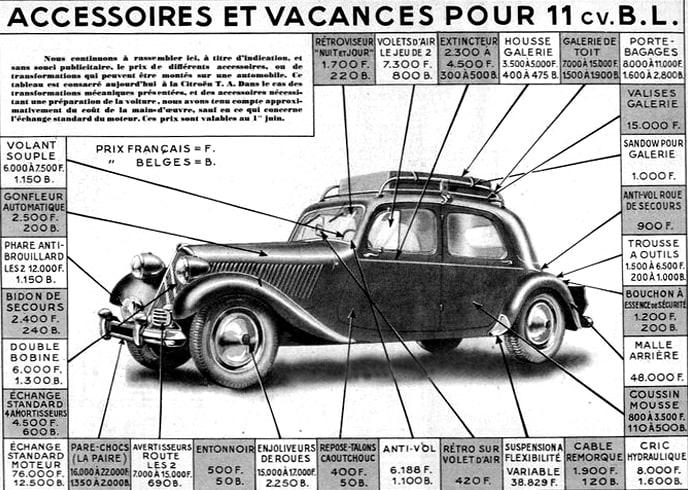

- [Le catalogue des accessoires Citroën 7 et 11CV](/documents/accessoires-citroen.pdf)

## Les accessoires mécaniques

- [Les boîtes 4 vitesses](/de-34-a-57/boites-4-vitesses/)
- La suspension Grégoire
- La triangulation du train avant

## Les accessoires carrosserie

- Les malles accessoires
- Les phares encastrés
- Les mascottes de calandre
- Les roues accessoires
- [Les volants souples Quillery](/de-34-a-57/volants-souples-quillery/)
- Les marchepieds

## Les accessoires pratiques

- [Les galeries et porte-bagages](/de-34-a-57/galeries-de-toit-et-porte-bagages/)
- [Les antivols](/de-34-a-57/antivols/)
- [Le super-accélérateur MARVEL](/de-34-a-57/super-accelerateur-marvel/)

Les sujets sans lien n’ont pas pu être récupérés de l’ancien site : ils seront republiés prochainement.

