La transformation de la boite trois vitesses en quatre vitesses permettait d’obtenir un accroissement des performances justifié par la puissance du moteur des Traction Avant. A performances égales elles procuraient une économie de carburant de l’ordre de 10 à 15% avec une vitesse du moteur réduite.

## Boîte Duriez-Lepicard
La boite Duriez se compose de trains d’engrenages du type Lepicard qui remplacent les engrenages de la boite de série Citroën en fournissant quatre combinaisons de marche avant et une marche arrière. La commande s’effectue par le levier normal disposé sur la planche de bord pour les vitesses avant, la marche arrière est actionnée par un petit levier spécial.
Montage des trains sur deux arbres. La 4ème vitesse procure un gain de surmultiplication de 17% par rapport à la 3ème vitesse d’origine. La marche arrière s’obtient par mise en prise d’un couple d’engrenages de renversement, dont l’axe bascule à l’aide d’un excentrique : dans les quatre combinaisons des vitesses avant, cet ensemble de pignon double se trouve isolé : ces pignons tournant à grande vitesse dans la boite d’origine, leur mise hors service rend la transmission plus silencieuse et l’usure des dentures est réduite.   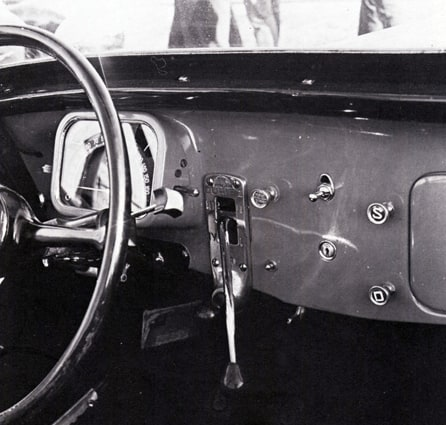

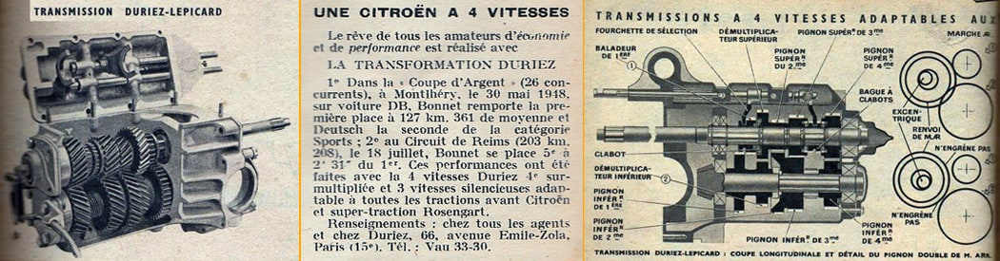

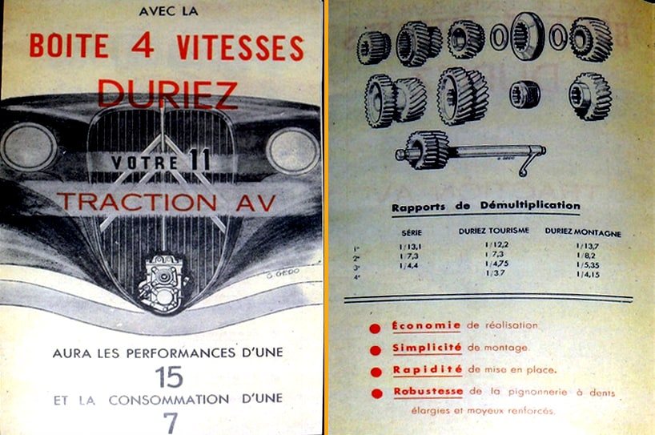

## Boîte Reda
La boite Reda comporte également quatre vitesses de marche avant et une marche arrière, les 3ème et 4ème combinaisons se trouvant respectivement étagées au-dessous et en dessus de la 3ème combinaison des changements de vitesse de série Citroën. Ces vitesses sont inclues dans un carter spécial.

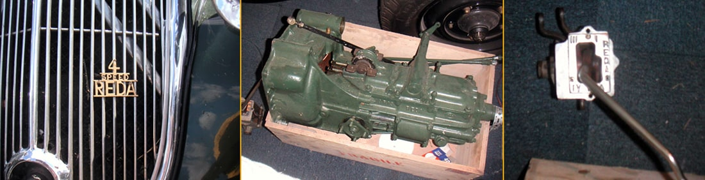

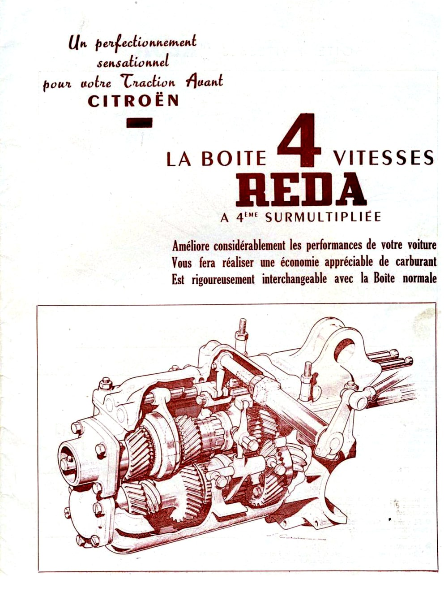   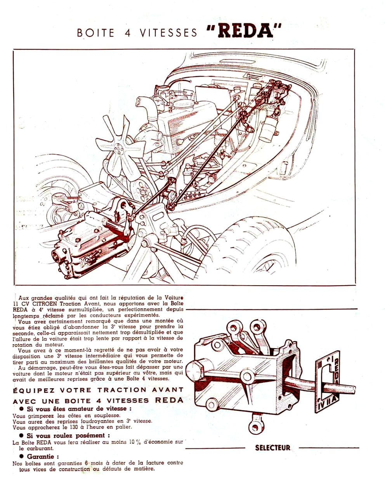 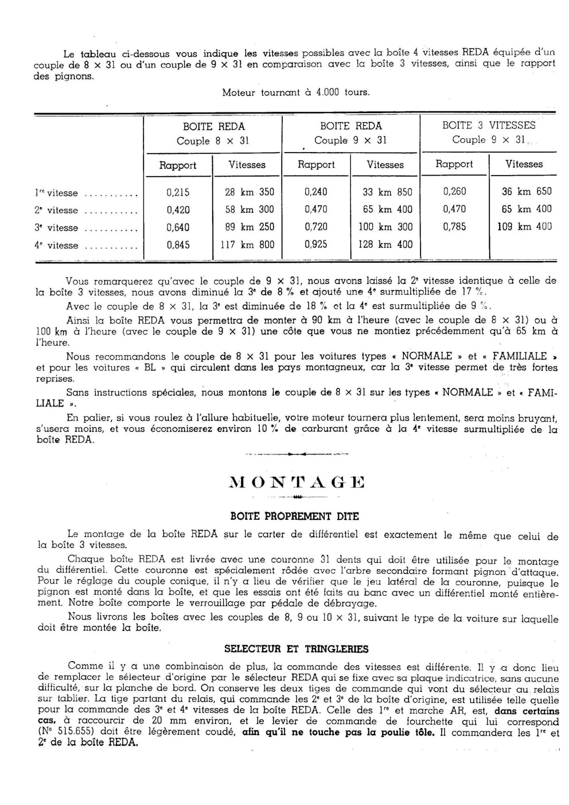   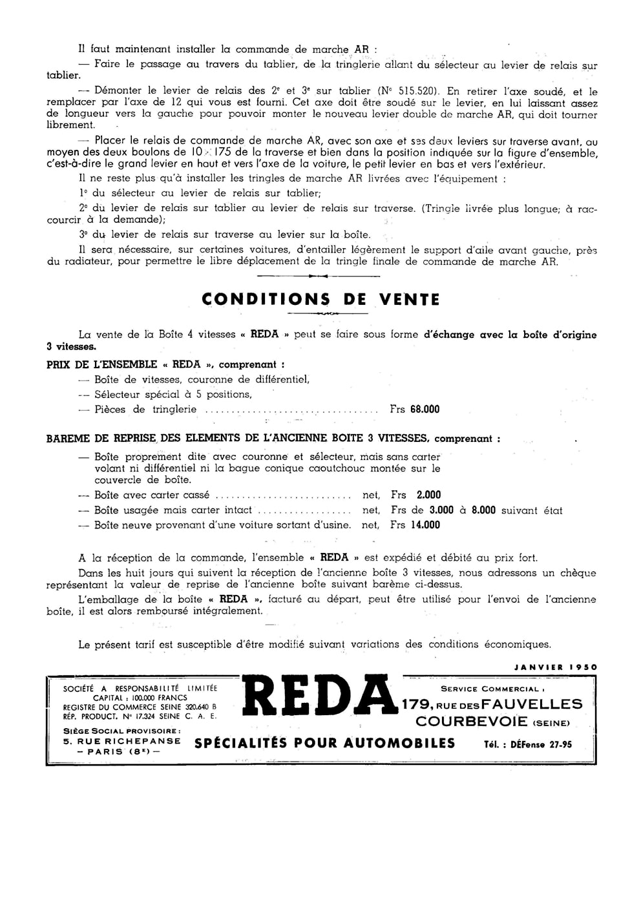

## **Boîte Cota**l Maag
Elle est composée de deux trains d’engrenages cycloïdaux formant quatre combinaisons de vitesses. Les combinaisons sont engagées par des électro-aimants commandés par une petite manette disposée sous le volant.
Cette boite dispense de l’emploi de l’embrayage mécanique au moins pour les 2e, 3e et 4e vitesses.

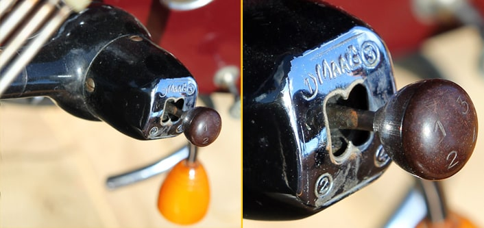

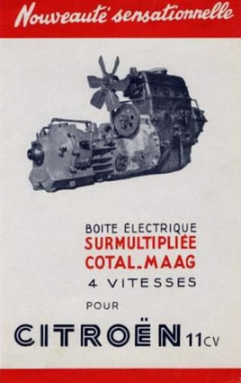

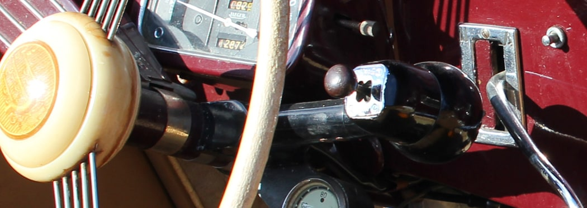

## Boîte Chatelet Michellet
Boite électromagnétique à 4 vitesses (dont une surmultipliée) à deux trains épicycloïdaux. Cette transmission se substitue à la boite d’origine, s’adaptant sans modification au carter du moteur. La sélection des vitesses s’opère par le blocage des engrenages planétaires des trains épicycloïdaux commandés par des électro-aimants fixes en rotation excités sous l’action d’une manette disposée sous le volant
Elle peut se compléter par le montage d’un embrayage électromagnétique Gravina qui fonctionne automatiquement. Lorsque le moteur est amené au ralenti, il se trouve débrayé, ce qui empêche tout calage du moteur, et pour le passage des vitesses, son dégagement et son engagement sont commandés électriquement sans intervention du conducteur.

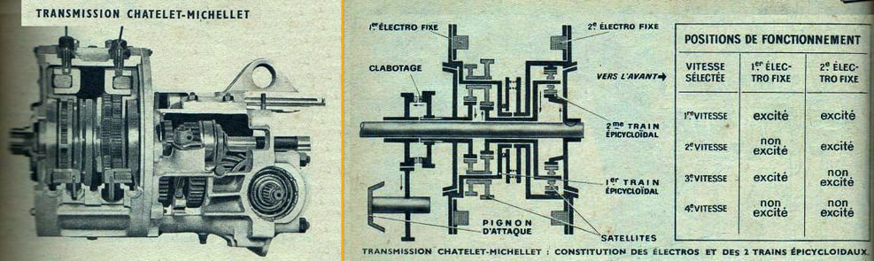
