André Citroën, dès le début des années 1920, comprend le besoin d’une communication forte auprès des professionnels et du grand public. Les voitures Citroën, produites en grandes séries doivent maintenant " inonder " le marché.
De nombreuses études sont menées et démontrent l’augmentation et surtout le potentiel du marché Français. Pour cela, la publicité est un parfait vecteur de développement et les Imprimeries des Usines Citroën y contribueront.
La grande majorité des documents commerciaux, des affiches, des publicités, des notices techniques et d’utilisation, des tarifs…. étaient produites dans ces imprimeries. Dès la sortie de la " 7 ", de nombreux documents sont produits, puis distribués et pour certains vendus.
Cliquez sur une couverture pour ouvrir le catalogue (PDF).

## 1935
[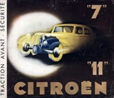](/documents/1935.pdf) [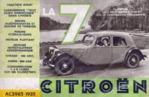](/documents/ac3965.pdf)
[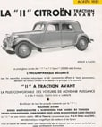](/documents/ac4176.pdf)
[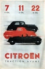](/documents/ac4220.pdf)
[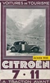](/documents/4414.pdf)
[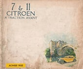](/documents/ac4435.pdf)
[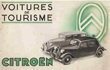](/documents/ac4469.pdf)
[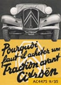](/documents/ac4475.pdf)
AC4475

## 1936
## , photo 1](../../../assets/content/ac4497.jpg)](/documents/ac4497.pdf)
, photo 2](../../../assets/content/ac4499.jpg)](/documents/ac4499.pdf)
, photo 3](../../../assets/content/ac4519.jpg)](/documents/ac4519.pdf)
, photo 4](../../../assets/content/ac4531.jpg)](/documents/ac4531.pdf)
, photo 5](../../../assets/content/ac4540.jpg)](/documents/ac4540.pdf)
, photo 6](../../../assets/content/ac4541.jpg)](/documents/ac4541.pdf)
, photo 7](../../../assets/content/ac4542.jpg)](/documents/ac4542.pdf)
AC4542

## 1937

[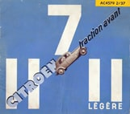](/documents/ac4579.pdf)

[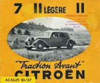](/documents/ac4625.pdf)
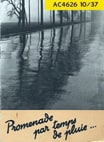

AC4627

## 1938
[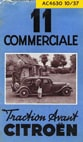](/documents/ac4630.pdf)
[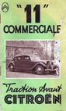](/documents/ac4659.pdf)

[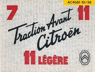](/documents/ac4681.pdf)
AC4681

## 1939
[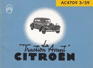](/documents/ac4709.pdf)
[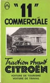](/documents/ac4710.pdf)
[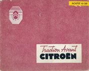](/documents/ac4710.pdf)

[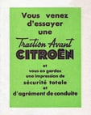](/documents/ac4723.pdf)

AC4726

## 1946
[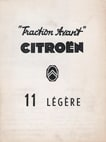](/documents/ac4793.pdf)
AC4793

## 1947
[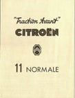](/documents/ac4802.pdf)
AC4802

## 1949
[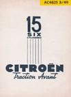](/documents/ac4825.pdf)
[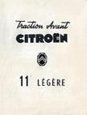](/documents/ac4836.pdf)
[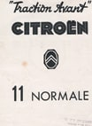](/documents/ac4841.pdf)
[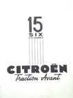](/documents/ac4842.pdf)
AC4842

## 1951
[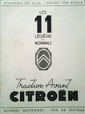](/documents/ac4903-1951.pdf)
[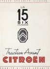](/documents/ac4904.pdf)
AC4904

## 1952
[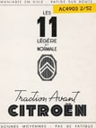](/documents/ac4903.pdf)
[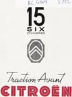](/documents/ac4904-1952.pdf)
[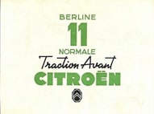](/documents/ac4960.pdf)
AC4960
  [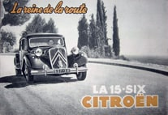](/documents/ac4969.pdf)
AC4969

## 1953

[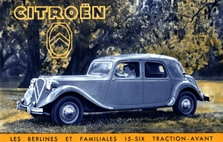](/documents/ac5011.pdf)
AC5011

## 1954
[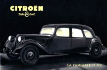](/documents/ac5019.pdf)
[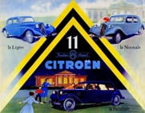](/documents/ac5026.pdf)
[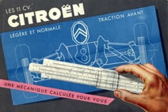](/documents/ac5048.pdf)
[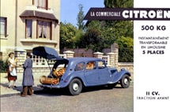](/documents/ac5049.pdf)
AC5049

## 1955
[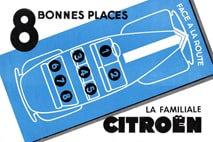](/documents/ac509.pdf)
[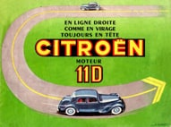](/documents/ac5095.pdf)
AC5095

## 1956
[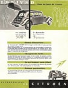](/documents/1956.pdf)
