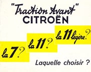
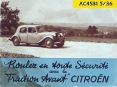
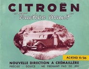
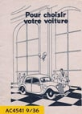
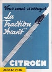

André Citroën, dès le début des années 1920, comprend le besoin d’une communication forte auprès des professionnels et du grand public. Les voitures Citroën, produites en grandes séries doivent maintenant " inonder " le marché.
De nombreuses études sont menées et démontrent l’augmentation et surtout le potentiel du marché Français. Pour cela, la publicité est un parfait vecteur de développement et les Imprimeries des Usines Citroën y contribueront.
La grande majorité des documents commerciaux, des affiches, des publicités, des notices techniques et d’utilisation, des tarifs…. étaient produites dans ces imprimeries. Dès la sortie de la " 7 ", de nombreux documents sont produits, puis distribués et pour certains vendus.
_cliquer sur les images pour télécharger les documents_

- **1935**

 
AC3965 
AC4176 
AC4220 
AC4414 
AC4435   
AC4469 
AC4475

- **1936**

****
AC4497 
AC4499 
AC4519 
AC4531 
AC4540   
AC4541 
AC4542

- **1937**

AC4577 
AC4579 
AC4606 
AC4620 
AC4625 
AC4626 
AC4627

- **1938**

AC4630 
AC4659 
AC4679 
AC4680 
AC4681

- **1939**

AC4709 
AC4710 
AC4717 
AC4719 
AC4723 
AC4726

- **1946**

AC4793

- **1947**

AC4802

- **1949**

AC4825 
AC4836 
AC4841 
AC4842

- **1951**

AC4903 
AC4904

- **1952**

AC4903 
AC4904 
AC4960
  
AC4969

- **1953**

AC4992 
AC5009 
AC5011

- **1954**

AC5019 
AC5026 
AC5048 
AC5049

- **1955**

AC509 
AC5095

- **1956**

