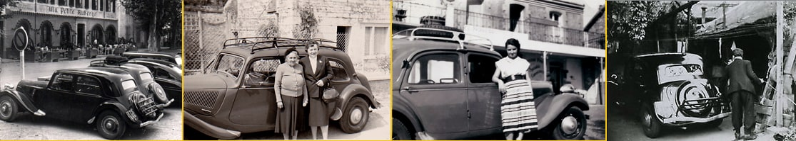

Pour remédier au manque de volume des malles plates des Traction, de nombreux accessoiristes se sont lancés dans la fabrication de galeries de toit et porte-bagages arrière.

**Les galeries Tubauto**
La société Tubauto à Levallois Perret produisait des galeries de toit "Aviation ".
Aérodynamiques, avec des flancs profilés en duralinox épousant la forme de la voiture et un plateau porteur en acier peint, elles s’appuyaient sur toute la longueur du toit par 2 patins caoutchouc évitant le risque d’enfoncement local du pavillon.
Elles étaient équipées d’un système de fixation auto-serreur à montage rapide et de ridelles rabattables et réglables à l’avant et à l’arrière assurant ainsi un calage correct du chargement.
Ce modèle est assez rare à dénicher aussi vous trouverez plus facilement aujourd’hui une refabrication moderne plutôt qu’un modèle d’origine.

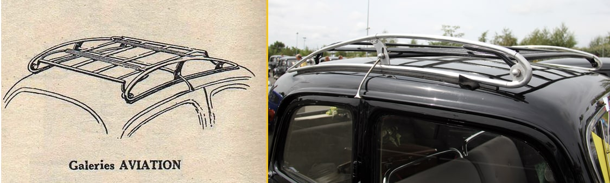
    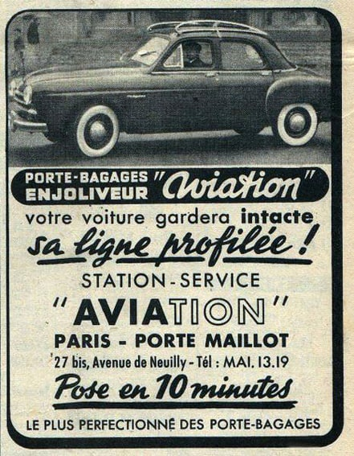

**Les galeries et portes bagages OLD**

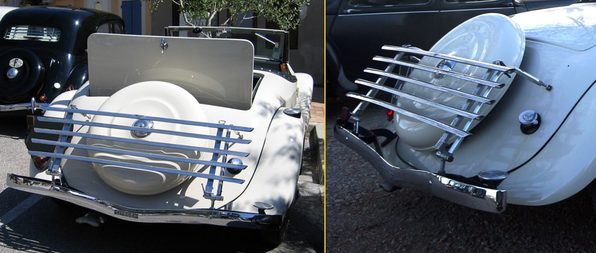
Le porte bagage arrière en métal blanc poli était entièrement réglable et articulé. Il se fixait au pare-chocs arrière et à 2 points de la carrosserie.

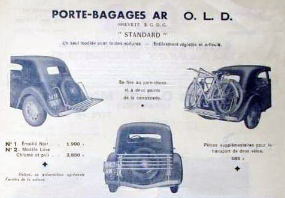 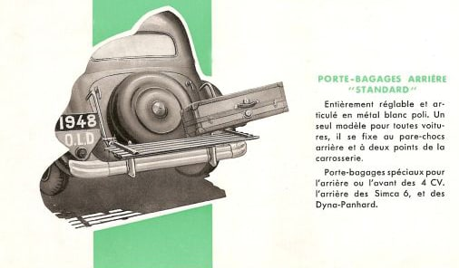
    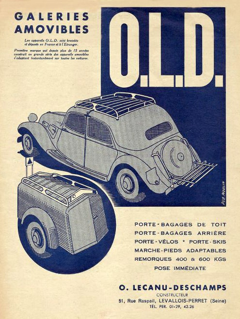 Les galeries métalliques OLD, produites après la guerre, étaient posées sur 4 patins en caoutchouc avec des coupelles qui les rendaient orientables automatiquement en fonction de l’inclinaison du toit. Elles étaient fixées aux gouttières par 2 pattes centrales serrées simplement par une molette, leur système de fixation ne nécessitait donc aucun outil.
Il existait différents modèles, le standard en acier brut ou peint apprêt noir, le Luxe Alu Bois, tout alu, Acier inox ou encore un modèle spécial pour voiture à toit ouvrant.
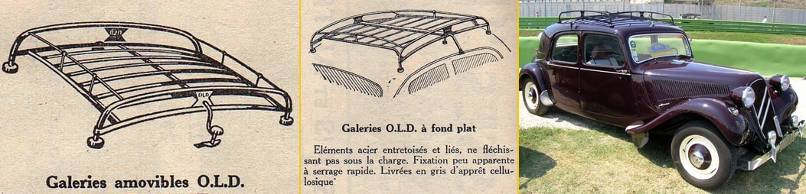

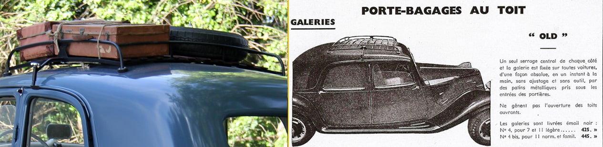    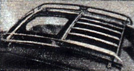

**Les galeries et porte-bagages Eyrem

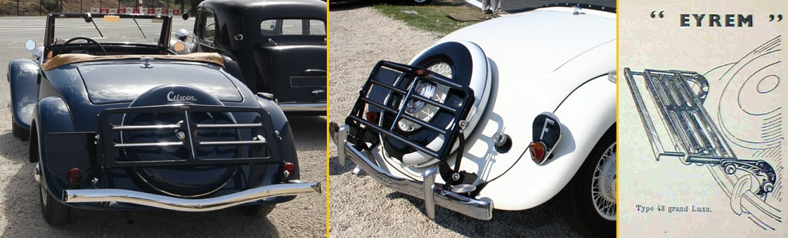**

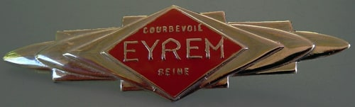 Les Etablissements A. Riviere fabriquaient à Courbevoie les porte-bagages de marque Eyrem.   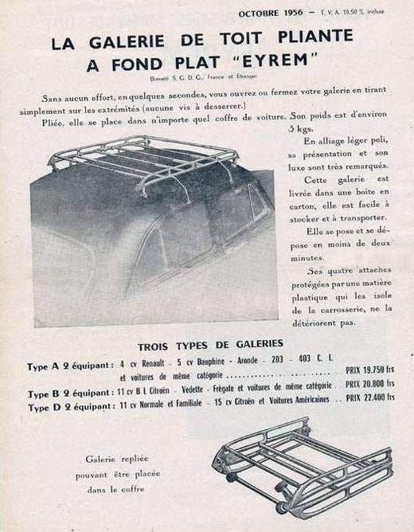

Solides et légers à la fois, ils étaient construits en tôle emboutie, laqués noir et avaient en option des baguettes chromées. Fixés sur les supports de pare chocs arrière ils se montaient en quelques minutes sans percer aucun trou.
Le modèle type 48 dit ‘’grand Luxe’’ était extensible permettant de régler la largeur suivant les dimensions des valises.

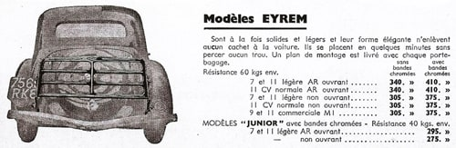

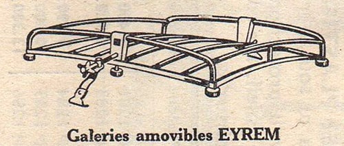

****Les galeries et porte-bagages Nerva et Hercule****

La société G. Ollivier basée à Levallois-Perret était spécialisée dans la fabrication de strapontins et porte-bagages.

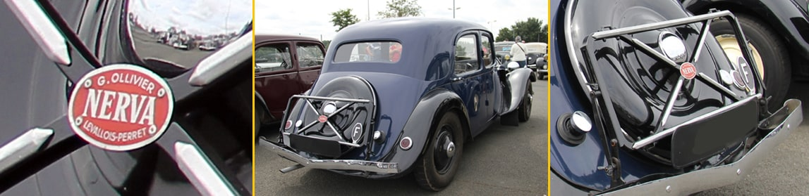

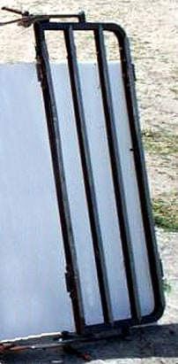

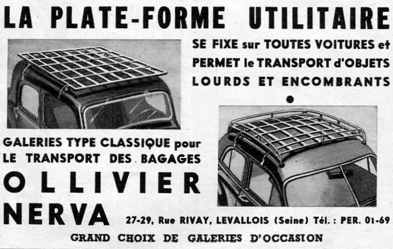

Les porte-bagages de toit NERVA se posaient rapidement et simplement par 4 crochets métal pris dans le jeu des portières.
Ils se faisaient soit complets avec cadre formant plateforme et pouvant recevoir tous les chargements, soit les 2 barres seules.

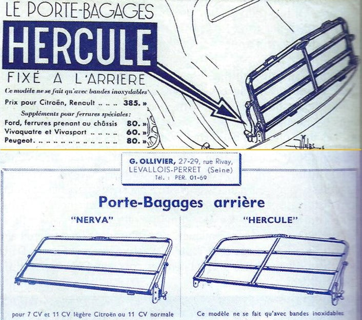

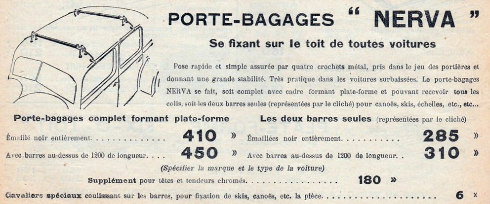

**Les galeries et portes bagages Supless**
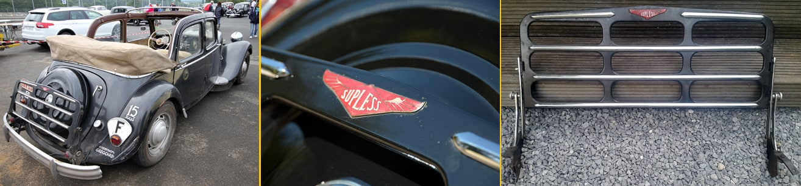

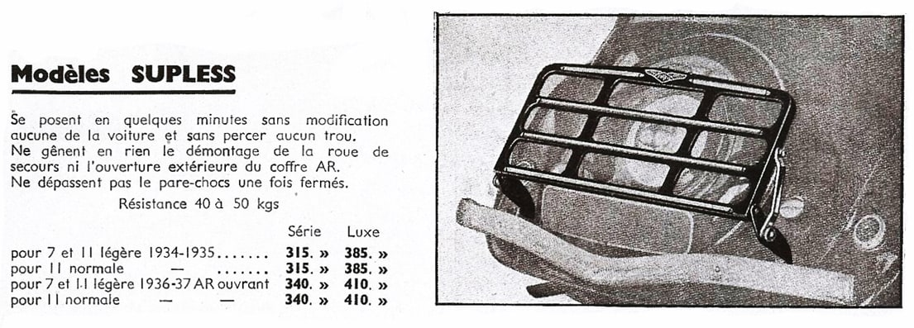   Fabriqués dans l’usine située à Paris les portes bagages Supless se fixaient en quelques minutes sans percer aucun trou.

Supless fournissait également les galeries ‘’Portex’’ qui se fixaient aux gouttières et existaient donc en différentes dimensions afin de s’adapter aux différents véhicules. 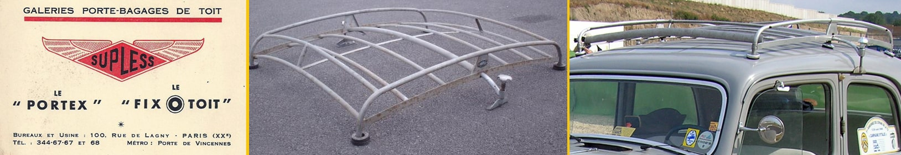

**Les Fix-o-toit**
Les différents équipements Fix-0-toit étaient conçus pour s’adapter à tous les véhicules. La fixation comporte 2 sangles passant à travers la voiture.
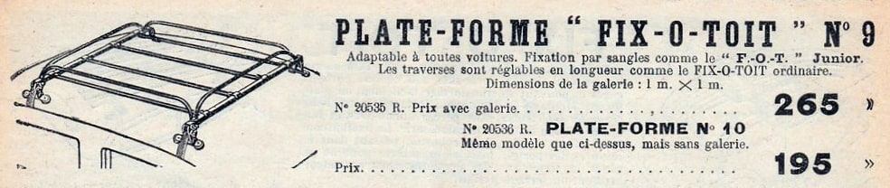

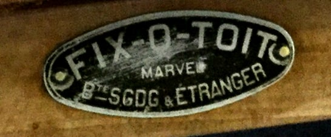

  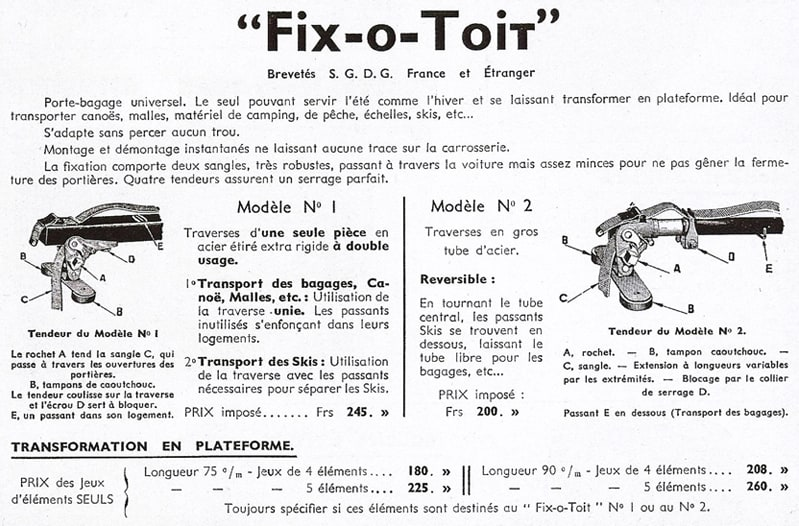 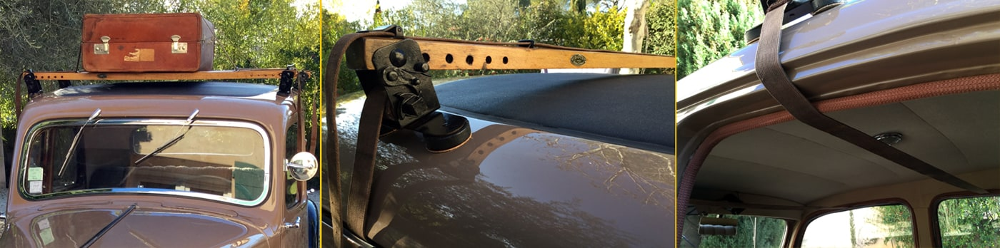

**Le porte-bagages RIGIDEX**

 **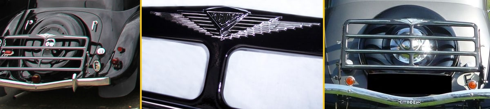 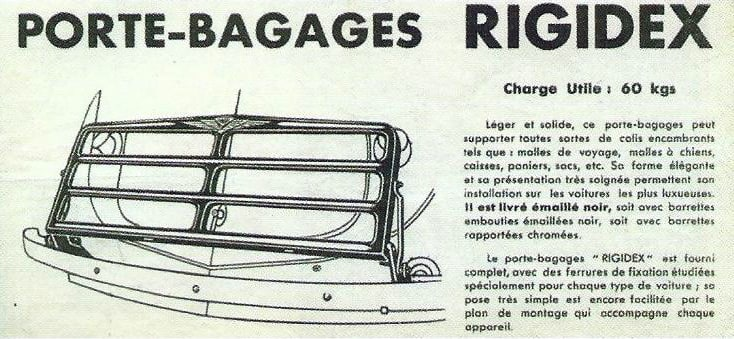**

**Diverses marques de porte-bagages et galeries**

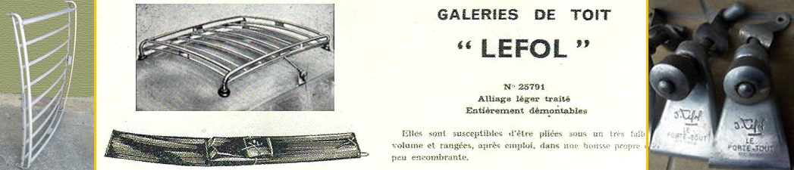

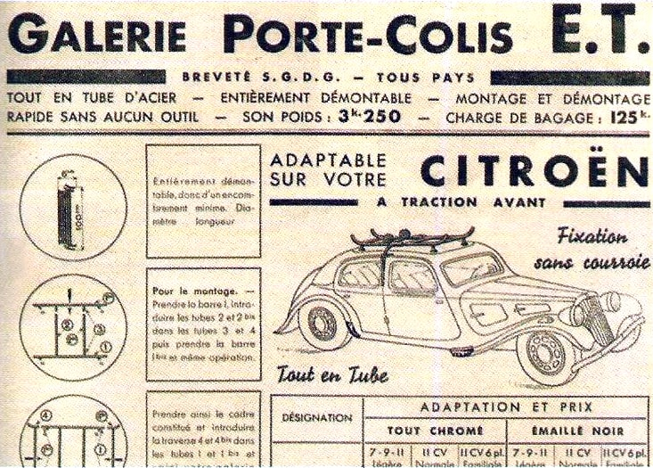

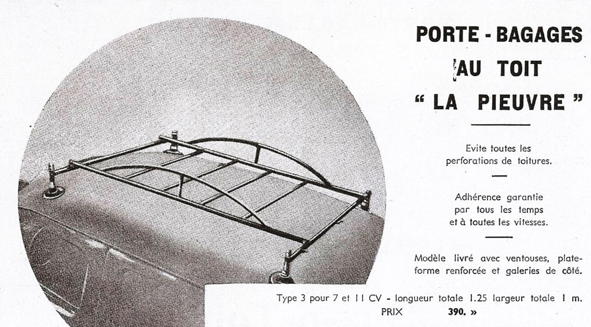

  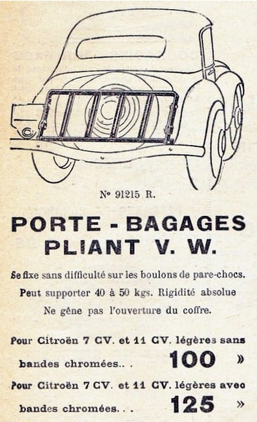

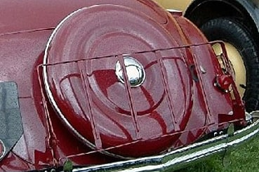
