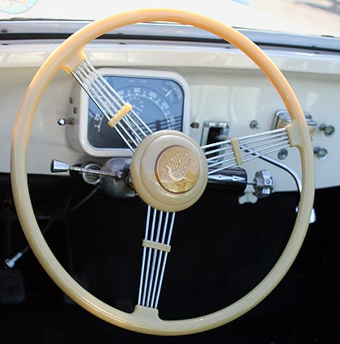
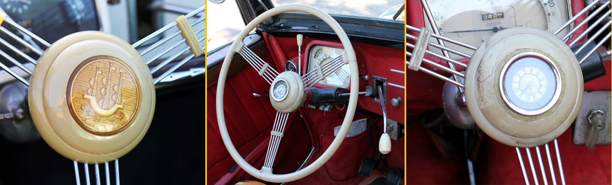
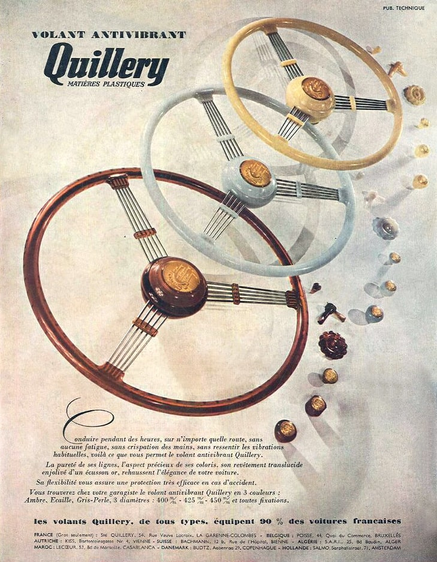
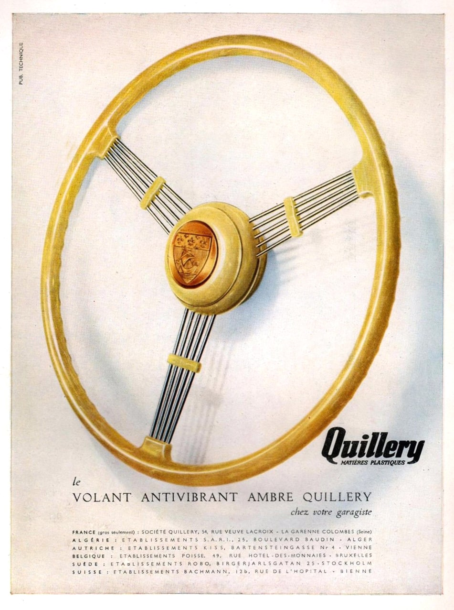
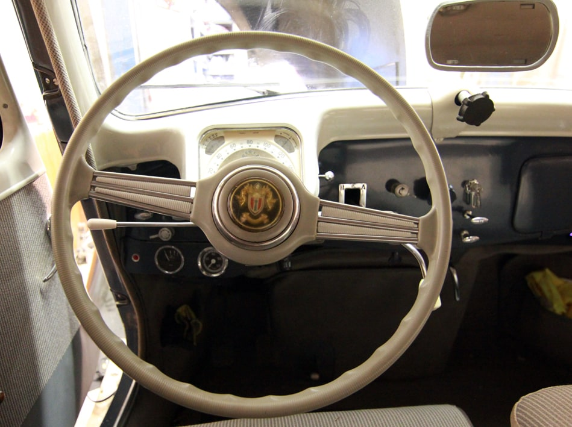
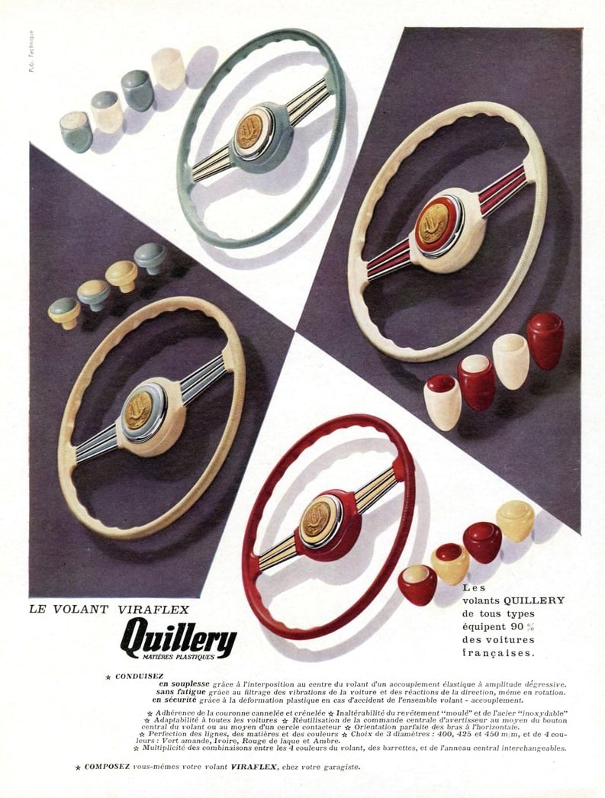
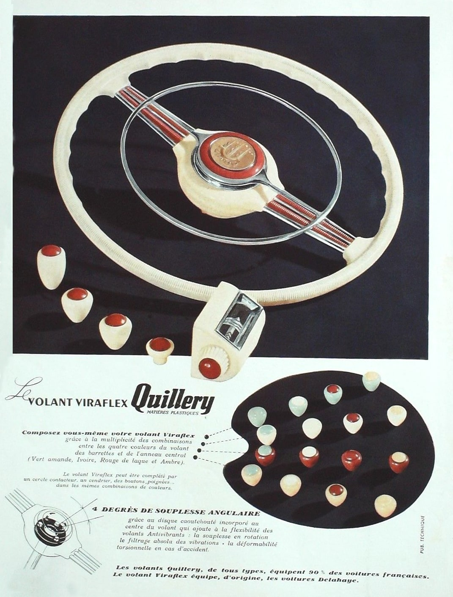
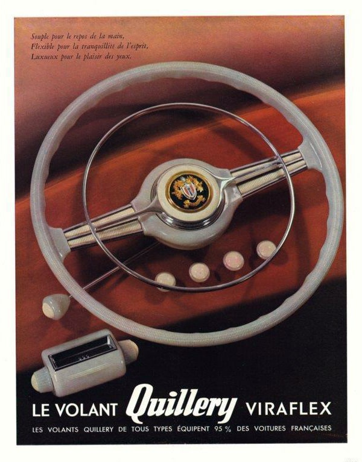

La société Quillery Matières plastiques installée à la Garenne Colombes était à l’époque le fournisseur exclusif des grandes marques automobiles dont elle fabriquait les volants accessoires.

Quillery équipa donc la Traction avant avec des volants en matière moulée et acier inoxidable pour remplacer les volants d’origine et les proposa en 2 diamètres 42,5 centimètres pour les 7C et 11 BL et 45cm pour les 11B et 15.
Pour respecter la monte d’origine on apercevra plus souvent les volants 3 branches sur les Traction d’avant 50 et les 2 branches sur les modèles après 52.

Si vous souhaitez acheter un modèle de volant Quillery, vous le trouverez assez souvent avec une barrette ou une partie du centre absente ou déteriorée.

**Le volant antivibrant 3 branches**
Proposé en teinte ambre, gris perle ou écaille et branches en cordes à piano, il assurait une conduite plus agréable sans ressentir les vibrations habituelles tout en donnant à la voiture un cachet d’élégance.    

 En France la montre de volant était assez à la mode, certains volants étaient ainsi équipés de montre centrale, le plus souvent de marque Centromatic qui monopolisait ce marché.

**Le volant Viraflex 2 branches**
Vendu à partir de 1951 en remplacement du volant antivibrant 3 branches, il était possible de composer soi-même son propre volant en combinant parmi les 4 couleurs proposées Vert amande, Ivoire, Rouge de laque et Ambre pour le volant, les barrettes et l’anneau central.
Le volant Viraflex pouvait être complété par un centre contacteur, un cendrier, des boutons et des poignées dans les mêmes teintes.
Il offrait une conduite souple, flexible et sans fatigue grâce au filtrage des vibrations et une meilleure adhérence dûe à sa couronne crénelée et cannelée.

        
