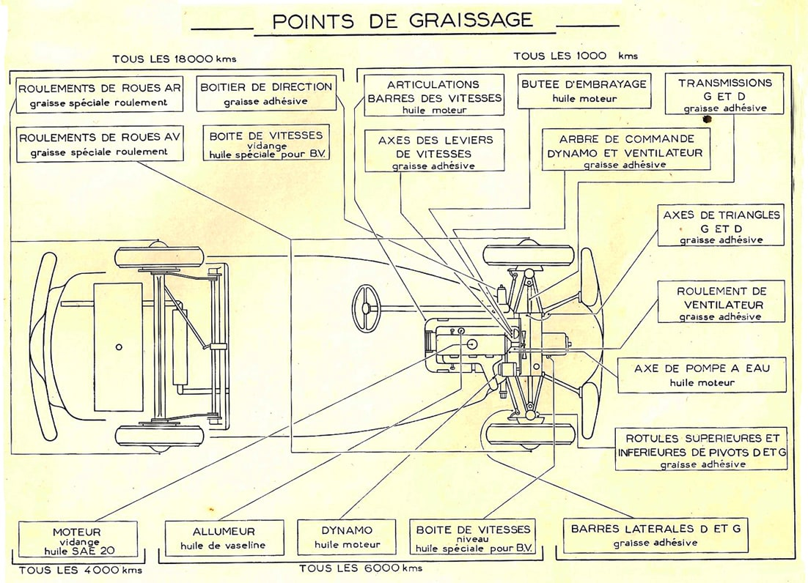
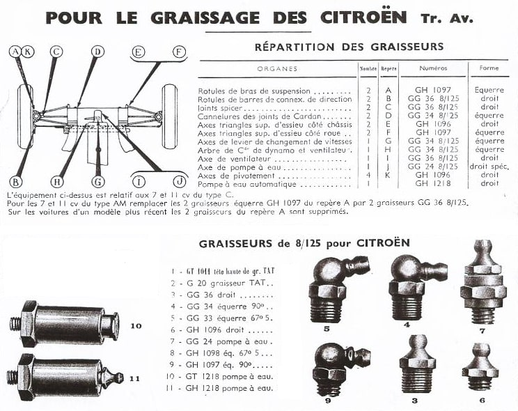

Un graissage complet et régulier est la base d’un bon entretien de votre Traction

**Tous les 1000 kms**

-  Arbre de transmission 1 à D et 1 à G (joints + cannelures)
-  Rotules de bras de suspension 2 à D et 2 à G
-  Rotules de barres latérales de direction 1 à D et 1 à G
-  Arbre de commande de dynamo et du ventilateur
-  Roulement de palier du ventilateur
-  Axes de triangles de l’essieu avant 2 à D et 2 à G
-  Axe de levier de changement de vitesses
-  Axe de pompe à eau
-  Butée de débrayage
-  Articulations des barres de commandes des vitesses (8 points)

**Tous les 3000 kms**

-  Vidange du moteur, vérifier souvent le niveau et faites l’appoint dès que le niveau approche ‘’MIN’’.

**Tous les 6000 kms**

-  Vérifier le niveau de la boîte de vitesses l’huile doit affleurer ; compléter si nécessaire avec de l’huile spéciale pour boîte de vitesses
-  Palier de dynamo
-  Allumeur - avance automatique
-  Nettoyer le filtre à air

**Tous les 20000 kms ou lors d’un démontage**

-  Le boîtier de direction et le câble de commande de compteur
-  Le câble des tirettes du démarreur et du starter
-  Les roulements de roue arrière et avant
-  Vidanger la boîte de vitesses et refaire le plein d’huile

[**Cliquez sur ce lien pour télécharger le plan**](/documents/plan_de_graissage.pdf)

