Depuis plus de 40 ans, nous aimons balader en Traction, à côté de chez nous ou plus loin en France, en Europe et même sur d’autres continents. Tout est plaisir en Traction, nous apprécions rouler, voyager, et surtout nous retrouver pour partager des moments de convivialité autour de piques niques gargantuesques. Notre sortie incontournable à ne pas manquer : Pentecôte. Pendant 3 jours nous avons la joie de parcourir ensemble les routes en Traction à la découverte de belles régions.

**2019, Centenaire Citroën à la Ferté Vidame**
Du 15 au 23 juillet, direction le centenaire du siècle pour 3 jours exceptionnels avec un stop de quelques jours à la découverte des bords de Loire entre Saumur et Angers…

[Voir toutes les photos](https://photos.google.com/share/AF1QipO1qyP9s-pTh2C1CvVCn7jVkjbjNUxOJCPJ3OPlB-3DlMdteOmnkpf4JgHovNcRGw?key=Mm1OYWt3WU9DYjhZWmtocTJsVzhXV3kzQldjb2RR)

  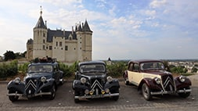

**2019, L’Aubrac en Trac**
Du 8 au 10 juin, à la découverte des paysages et des spécialités culinaires de l’Aubrac, Laguiole, Estaing, Espalion, La vallée du Lot, un petit tour sur le Viaduc de Millau et une belle rencontre avec ’’les Rois de la Route’’ …

[Voir toutes les photos](https://photos.google.com/share/AF1QipN0-XYhGgDnjVsgxYxy0m-SPdSObNP_dTT9EufvzaYRqMq_Z8s28j2iN21fG8M3Lw?key=aUxaSGU1ZmpSWjUwdGJhMlVJRUhQN3EzWVJSQmhn)

  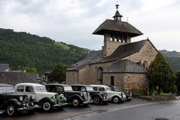

**2018, Citronnades**
Du 8 au 9 septembre, 8ème concentration de Citroën à Ste Marie la Mer qui mettait à l’honneur le jaune citron…

[Voir toutes les photos](https://photos.google.com/share/AF1QipPR3FGw-X24Wu5g9i5JBGSSFc0kxtBN9anfTk6l8vzwjsM0PIPAXk-_Xegm5N6Y0g?key=LTdQVkFLV1RoWE1HSk43QV93MDdFeW8xRGJkb1RB)

  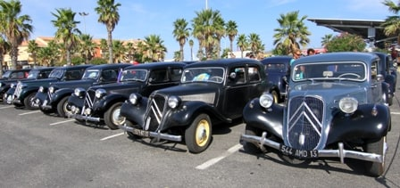

**2018, Autour du Géant de Provence**
Du 19 au 21 mai, à la découverte du versant sud avec l’Abbaye de Sénanque et les gorges de la Nesque, le versant nord avec la vallée du Toulourenc, mais aussi les dentelles de Montmirail et bien sûr l’ascension du Mont Ventoux …

[Voir toutes les photos](https://photos.google.com/share/AF1QipOnb8BXp3LUjH2WrDIMsRgGc2KKXH7-s98lynpx6Yapo0C6C3i42M9dAyFZMhVonA?key=S01iQXFMZ05CRmJpaTUzQV9laG5UV3NiY29ZejBB)

  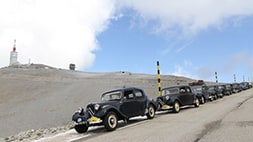

**2017, Le Verdon**
Du 29 septembre au 1er octobre, très belles routes du grand canyon du Verdon, la corniche sublime et la route des crêtes avec arrêt au barrage de Ste Croix, visite du Château d’Allemagne en Provence, du village Médiéval de Trigance, le vieux Cotignac, la cascade de Sillans …

[Voir toutes les photos](https://photos.google.com/share/AF1QipM7_sOZDIuzlGf7o77FVTZU3zAX3DlMWoWlZoDgsnxsz0wWbGqZul-pEI14aT5iVA?key=SkJyemtfcWJ3SHl5aVVIeEZ4cHBnY0JkRzJtTlJB)

  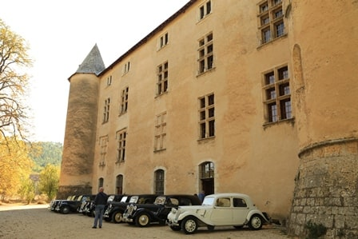

**2017, Citronnades**
Du 9 au 10 septembre, 7ème concentration de Citroën à Ste Marie La mer avec de nombreuses animations et 700kms de plus pour nos Traction …

[Voir toutes les photos](https://photos.google.com/share/AF1QipMpKu8X7vEbG6oiBZaLHYNxy_anc-H8Lit_UqDnLWwek6EVpLFR7sHT_KGvtb6yIw?key=ay1BNElURlhWR192Qi1ORkh6a1JxOC1mZFJNZFl3)

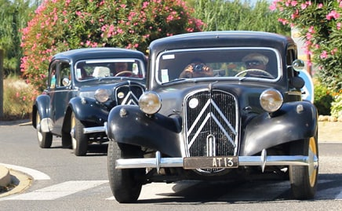

**2017, Trac’Pignes**
Du 3 au 5 juin, de sympathiques routes par Vinon sur Verdon, les Mées, Valenlose, Digne, Riez et une magnifique balade avec le train des Pignes de Puget Theniers à Annot…

[Voir toutes les photos](https://photos.google.com/share/AF1QipPLf5zu70ZXRSQIX23RhH3BSbrvSvysy254BsH5xfy4BA1HwDtrdn5Gu6igF5534Q?key=Y0puSUs5QVJXbkYzMmlPYkQ2Wkx0MkRsWGpEckhB)

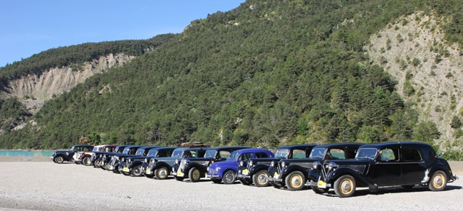

**2017, Habemus Tractionam 2 Le retour**
Du 15 au 17 avril, visite de Sommières et de St Martin de Londres, découverte des chapelles et Abbayes de la région en compagnie de nos sympathiques guides Loïc et Fabrice…

[Voir toutes les photos](https://photos.google.com/share/AF1QipPJCUNcJQs8xL6fYAGOkqgnddrvGXGOKdkh7uH4GGTUG_O-FlOSWMkRsO4DGHIZnQ?key=R1FFNmR1VURzUFNEdXAzbXJxX2F3cW9tMWpDV3BB)

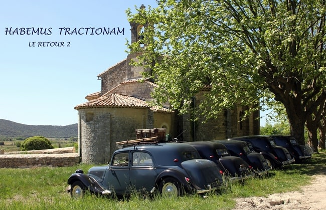

**2016, Citronnades**
Du 10 au 11 septembre, participation à la 6ème concentration de Citroën à Ste Marie La mer et son concours d’élégance…

[Voir toutes les photos](https://photos.google.com/share/AF1QipPnUXMGVKJ_LLOlGPh_AZvtau1w037herhhYTsnBjWQabPF2aKs7aeXFWB-cPKjLg?key=OUk0RlM4UDZWS2dwMTJRZTFqTEdDdUFkTGdQR3RR)

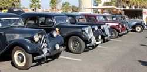

**2016, la Drô****me des collines**
Du 14 au 16 mai, circuit de la forêt de Saou à Hauterives en passant par Crest, Tain l’Hermitage, la route des vins, Mercurol…

[Voir toutes les photos](https://photos.google.com/share/AF1QipPA00ITTCEbJHh2laOW4QKexhQRCN21juki9v7opr2AFmPG2HxvHVwwOz-Y-j9kMw?key=V21Ma3dKWld3RlB5WDlOaVUzbVVqVU5tQWRJVFhR)

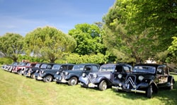

**2015, Citronnades**
Du 12 au 13 septembre, 5ème concentration de Citroën à Ste Marie La mer et visite de Salses le Château…

Voir toutes les photos

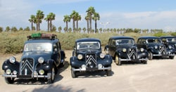

**2015, Habemus Tractionam**
Du 4 au 6 avril, week-end Pasqual autour de l’étang de Thau à la découverte des abbayes de la région, Pézenas, Villeneuvette…

[Voir toutes les photos](https://photos.google.com/share/AF1QipM7PmXIFex8yLz1HlaQhz4W92Uewutl3k9UitmcbwTNBKOCWKEafTz-ybjHXwsSlg?key=bTJPcDNSVjA2ekh1QkFnX19xN01RakhYa0dCY1RB)

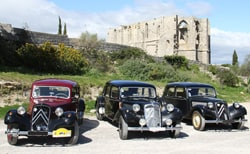

**2014, Eurocitro au Mans**
Du 6 au 12 août, Millau, Rocamadour, Limoges, Amboise, Tours puis enfin Le Mans pour participer à l’Eurocitro.…

Voir toutes les photos - [Voir la vidéo](https://www.youtube.com/watch?v=IgQw-lsF0a0)

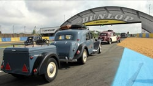

**2014, Rallye en Corse du Sud**
Du 28 mai au 3 juin, circuit de 6 jours à la découverte d’Ajaccio, Porto Pollo, Ghisoni, Cargese, Piana, Bastelica…

[Voir toutes les photos](https://photos.google.com/share/AF1QipMse2G6WkLrK6xKnRr0JbdgPYu65gY5ReI3RO1jIOrlu0FGr7TKOMAOwJhRaC0OWg?key=QmRvd2tWd2lBcVl4R0hsa05xamI3TXRaS1FkWjB3)

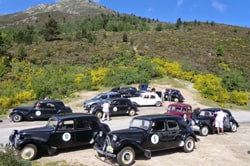

**2013, Viva España**
Du 8 au 12 mai, à la découverte de la Costa Brava.
Cala Montjoï, Figueres et le musée Dali, Barcelone, Cadaques…

[Voir toutes les photos](https://photos.google.com/share/AF1QipOdQtvEohkM7m3Hk1Ze7DjHAVRieJC5WLrlCwGbbuGzwWwohXRc-KL1-BSklgtv1w?key=eHEtU3ZXc2Q2bkFod19mTXhzU0RiOWk0bnl2RnJB)

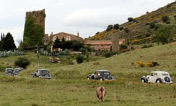

**2013, 101 Traction pour Jean Moulin**
Du 18 au 20 mai, participation à la manifestation organisée par le collège Jean Moulin de Montceau Les Mines…

[Voir toutes les photos](https://photos.google.com/share/AF1QipPn2H_I-F_8vz_QfI3hw7pVoWZqEo4v4T26KpXGohJSK7Oo_Pus67dz1CiWiYDkcA?key=REJWeVBqSnBkamFreGlrLWFhSHNkcDYxR0tDaHpn)

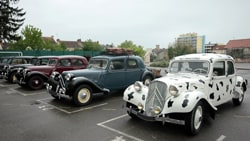

**2012, Citronnades à Ste Marie La mer**
Du 8 au 9 septembre, participation à la 2ème concentration de Citroën et visite guidée de la vieille ville de perpignan…

[Voir toutes les photos](https://photos.google.com/share/AF1QipMz555rITLkPqMyv8ZcBuxe0FvSUouznrzed01VjhprLZIN-lCNjmXGRA3KXSM0bw?key=WXRJTWxkS1p3VVZDUFBwQzhMTjVxUG9rSnlVLWpB)

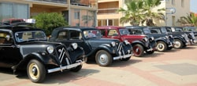

**2012, Pentecôte en Lozère**
Du 26 au 28 mai, la corniche des Cévennes, Marvejols, Grèzes, Ste Enimie, les gorges du Tarn, le château de Miral…

[Voir toutes les photos](https://photos.google.com/share/AF1QipNhItmR0ZjWj1cwnyY1Y-RFpQqC-hvsMLjCVBJiTNSMkflw7dZ4LKzxt5kGHVGRmA?key=REl6eS1NY0pBdERfRGNneFhta1djbUVCUXJNdmt3)

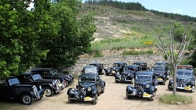

**2011, Citronnades**
Du 10 au 11 septembre, 1ère concentration de Citroën à Ste Marie La mer proche de Perpignan, balade sur la côte…

Voir toutes les photos

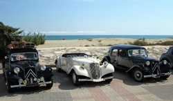

**2011, une Traction pour Jean Moulin**
Du 24 au 27 juin, participation à la manifestation organisée par le collège Jean Moulin de Montceau Les Mines…

[Voir toutes les photos](https://photos.google.com/share/AF1QipN4KLpS0OQkauA1J2ct6OOsqaum002jAPJ_qJPdv1pwpTQ66d_7Frx-k2DSuJ4Mcw?key=aXhqMmNtcVhMN3p3MHhSeW10OTVhbmlsMkR5dl9n)

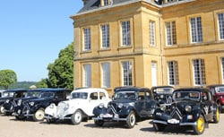

 **2010, Pentecôte dans le Lot**
Du 22 au 24 mai, circuit sur les petites routes par Alzon, Saint Jean de Bruel, Millau Saint Affrique pour rejoindre Saint-projet et visite des caves de Roquefort…

[Voir toutes les photos](https://photos.google.com/share/AF1QipOr3qLDYvAPLxvOHUZFFLCHU-CWx4YiWgpmCyBHRo-omneoAFCagwsP5aiNoqU2vA?key=ckI4LTlJcmZlMjZDVTN6V1IzQVpMR1g1aUIxcFZB)

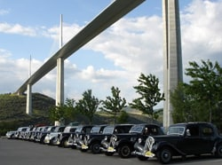

**2009, Eurocitro au Mans**
Du 9 au 22 août, un circuit de 2600 kms en passant par l’Aveyron, l’Auvergne, Montresor, Loches puis le célèbre circuit…

Voir toutes les photos

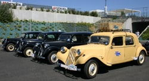

**2009, le canal du Midi**
Du 30 mai au 1er juin, Etang de Thau, Portiragnes, Ecluse d’Agde et de Fonsérannes et croisière sur le canal…

[Voir toutes les photos](https://photos.google.com/share/AF1QipP4RliN9VM0jxM9yomcMThnUMx_SBX0E2OkAiFDAUtRfpXFcrK90vzOxKnH9FhgsQ?key=bVQxNTZhRm5abktveS1BZGE1MlozR2twX2kwUjF3)

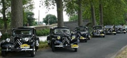

**2008, PastaTrac à Rome**
Du 11 au 24 août, 2250 kms en Italie pour participer à l’ICCCR à Rome, Lucca, Florence, Sienne, Viterbe, Pise…

Voir toutes les photos - [Voir la vidéo ICCCR](https://www.youtube.com/watch?v=h75RHrXLtMU) - [Voir la vidéo l’Italie en Traction avant](https://www.youtube.com/watch?v=9suc9F00dnU)

**2008, Autour du lac de Serre Ponçon**
Du 10 au 12 mai, Les Mées, Espinasses, Savines le Lac, les Demoiselles coiffées, Embrun et croisière sur le lac…

[Voir toutes les photos](https://photos.google.com/share/AF1QipPVGoA1D5BJBEQaROOsIB02VSMLAng5NKCUW7Uu8jIAKATxl8aeC1CPo8lYMyNcrQ?key=dWRlSjBoNjBaUzV2MGZqUmhvaWJ3SWVXRDluQ1hB)

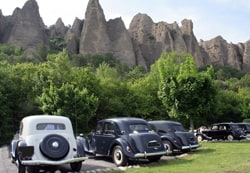

**2007, De gorge en Gorge**
Du 26 au 28 mai, circuit en Drôme provençale, Rustrel, Buis les Barronies, Mollans sur Ouvèze, Grignan, Suze la Rousse…

[Voir toutes les photos](https://photos.google.com/share/AF1QipONnZnPuhIKzzLyD-7NPZKipTZr8vmHw_m3SaFD6UoGfGlKdlJXEAsYBdljrkuAhg?key=aEh6d0M3Q0w0aDFNcHRRMEs4ZDd5RHlteWFEWS1R)

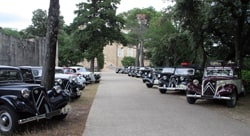

**2006, Routrac Tajines**
Du 16 au 29 avril, circuit au Maroc de Tanger jusqu’à Ouarzazate via Fès, Merzouga, les gorges de Dadès, Agdz, l’atlas…

[Voir toutes les photos](https://photos.google.com/share/AF1QipNyILnkfseiBjvVEzJMHIrxKmSBq0A38_p9Vtn8_qh_4D0QKll5Xv9cbBVZyh19nA?key=QUtLMlF4N215LTZDTkFPVkRsdDFjQ2pVemFsV0d3) \- [Voir la vidéo](https://www.youtube.com/watch?v=3REqcylQev8)

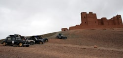
