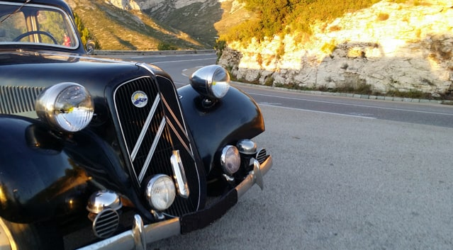

## Le club

**La Traction de Provence** 
195, avenue François Mitterrand 
13170 Les Pennes-Mirabeau

Courriel : [latractiondeprovence@gmail.com](mailto:latractiondeprovence@gmail.com)

Nous nous retrouvons au [Quai de Javel](/vie-du-club/quai-de-javel/) le premier vendredi de chaque mois à 21 heures.

## Le bureau

- Président : **Jean-Luc Richaud**
- Trésorier : **Jo Guaiana**
- Secrétaire : **Jean-Marc Van Morleghem**, 04 91 82 26 23
- Secrétaire adjointe : **Martine Guaïana**

## Les services

- Pièces détachées : **Jean-Philippe Delerce**, [ltdp.pieces@orange.fr](mailto:ltdp.pieces@orange.fr)
- Location d’outils : **Joseph Guaiana**
- Site internet et Lettre du Club : **Nathalie Delerce**

